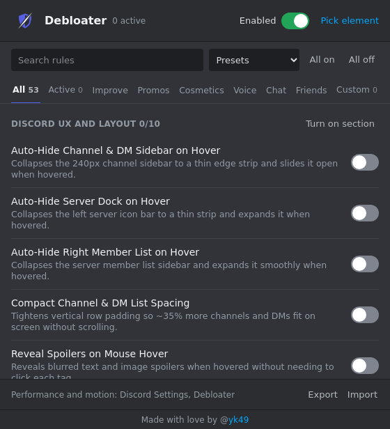

## ⚠️ ⚠️ ⚠️ Safety and limits (MUST READ) ⚠️ ⚠️ ⚠️

This extension changes how Discord looks in your browser. It does not change Discord's servers, your account data, or the messages you send. Still, no client-side tool can promise that a Discord account will never be flagged, and changing the Discord web client may conflict with Discord's Terms of Service. Use it at your own risk.

Discord updates its class names regularly. When Discord changes its page structure, some rules may stop matching until the extension is updated.

# Discord Web Debloater (if u have any problem, dm on discord at @yk49)

A Chrome extension that tidies up Discord in your browser. Hide ads and upsells, remove cosmetic clutter, clean up the chat, and add layout improvements. Every option is off by default, so you choose exactly what changes.

## Features

- **53 toggles** in the popup: 43 debloat rules and 10 layout Improvements.
- **Categories:** Interface, Promos, Cosmetics, Voice, Friends, Chat, and Improvements. Each category has bulk "Turn on section" / "Turn off section" buttons.
- **Active tab:** shows only the rules that are on.
- **Presets:** Ad and upsell free, No cosmetics, Minimalist and UX, Turn on all, Turn off all.
- **Master pause switch:** turn every rule off without losing your settings.
- **Custom tab:** add your own CSS, applied on Discord only.
- **Pick element:** click any element on Discord to hide it. Press Esc to cancel.
- **Export / Import:** save your settings as JSON and load them on another browser.
- **Debloater settings page:** a Debloater entry in Discord's Settings sidebar with Settings rules, Performance, and Motion pages.
- **Toolbar badge:** shows how many rules are active.

### Performance options

- Hide typing indicator
- Hide animated gradient glow
- Hide link previews
- Contain message list layout (reduces repaint cost in long chats)

### Improvements

Layout options such as auto-hide sidebars and server dock on hover, compact channel and DM spacing, reveal spoilers on hover, full-width code blocks, wider image previews, full profile bios and roles, streamer-friendly DM name blur, and minimal scrollbars.

## Installation

1. Download or clone this repository.
2. Open `chrome://extensions` and turn on **Developer mode**.
3. Click **Load unpacked** and select the extension folder.
4. Open Discord Web (`discord.com/channels/...`) and click the extension icon.

## How it works

- Changes are CSS only. The extension injects styles through `document.adoptedStyleSheets`, so the page gets no new `<style>` elements.
- Settings are stored in `chrome.storage.local`, which is kept inside the extension. It does not use `localStorage` on Discord.
- The extension does not call Discord's API, read your token, or load Discord's internal modules.
- Interactive overlays (the Debloater panel and element picker) use a closed Shadow DOM.
- Permissions: `storage` for saving settings, and `tabs` to send the "Pick element" command to the active Discord tab.

## Privacy

The extension collects no data and makes no network requests of its own. All settings stay on your device.

## Credits

Made with love by [@yk49](https://github.com/03133). Animations use [GSAP](https://gsap.com) (bundled in `lib/`).

## License

No license has been chosen yet. Until one is added, all rights are reserved by the author.

## Disclaimer

Discord Web Debloater is not affiliated with, endorsed by, or sponsored by Discord Inc. "Discord" is a trademark of Discord Inc.
